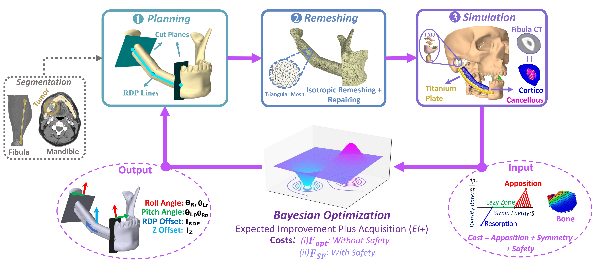
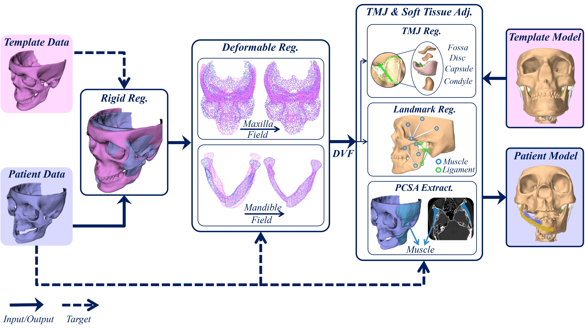

# OsteoOpt++: Patient-Specific Optimization for Mandibular Reconstruction Planning with Enhanced Bone Union

[](LICENSE)
[](#)
[](https://openjdk.org/)
[](https://www.python.org/)
[](https://www.mathworks.com/products/matlab.html)

OsteoOpt++ is the extended version of OsteoOpt, an image-to-decision
framework for mandibular reconstruction. It combines virtual surgical planning,
ArtiSynth simulation, and Bayesian optimization to search reconstruction
variables that improve predicted donor-host bone union.

Extended Journal version: [*Medical Image Analysis*](https://www.sciencedirect.com/science/article/pii/S1361841526003506).
Earlier conference version: [MICCAI 2025](https://www.researchgate.net/publication/395706192_OsteoOpt_A_Bayesian_Optimization_Framework_for_Enhancing_Bone_Union_Likelihood_in_Mandibular_Reconstruction_Surgery).

## News and Highlights 🎉

* **September 30, 2026** - Received the *Medical Image Analysis* Best Paper Runner-Up Award 🥈.
* **August 17, 2026** - Extended version accepted in *Medical Image Analysis* (Impact Factor: 14).
* **September 26, 2025** - Received the MICCAI 2025 Young Scientist Award 🏆.
* **August 27, 2025** - Nominated for the MICCAI 2025 Best Paper and Young Scientist Awards.
* **May 12, 2025** - Early accepted to MICCAI 2025 (top 9% of approximately 3,700 submissions).


**Demo: one optimization iteration for the Body (B) defect case.**

https://github.com/user-attachments/assets/8453a34e-4e47-47cb-96e5-db6c425aa94e

## Repository Layout

* `artisynth_JawModel/` - ArtiSynth jaw model, simulation code, and MATLAB
  optimization scripts.
* `artisynth_JawModel/src/artisynth/JawModel/patient_specific/` -
  patient-specific registration and model-construction scripts.
* `artisynth_VSP/` - virtual surgical planning and reconstruction components.
* `assets/` - README figures.

## Optimization Workflow



The optimization loop generates a candidate reconstruction, remeshes the
geometry, runs a chewing simulation, evaluates apposition and safety metrics,
and sends the cost back to the Bayesian optimizer.

Optimization entry points:

```text
artisynth_JawModel/src/artisynth/JawModel/matlab/MainOneSegment.m
artisynth_JawModel/src/artisynth/JawModel/matlab/MainTwoSegment.m
```

## Patient-Specific Registration and Modeling



The patient-specific layer is a registration and model-construction
preprocessing step. It registers the generic template model to CT-derived
patient anatomy, transfers muscle and ligament attachments, updates muscle and
ligament parameters, adapts the TMJ soft tissues, and produces the patient
digital twin used by the optimization workflow.

Patient-specific registration entry point:

```text
artisynth_JawModel/src/artisynth/JawModel/patient_specific/matlab/Registration_Artisynth_Main.m
```

See the [registration README](artisynth_JawModel/src/artisynth/JawModel/patient_specific/matlab/README.md) for detailed inputs and configuration.

## Setup

Tested on Windows.

1. Install **MATLAB**, **JDK 8 or higher**, and **Eclipse IDE**.

2. Clone **ArtiSynth Core**:

   ```text
   https://github.com/artisynth/artisynth_core.git
   ```

3. In Eclipse/ArtiSynth, add the model packages and make `artisynth_VSP` and
   `artisynth_JawModel` visible on the external classpath.

4. Set `ARTISYNTH_HOME` to the local `artisynth_core` checkout and configure
   the MATLAB interface. Replace the example path with your installation:

   ```matlab
   setenv('ARTISYNTH_HOME', 'C:\path\to\artisynth_core');
   addpath(fullfile(getenv('ARTISYNTH_HOME'), 'matlab'));
   setArtisynthClasspath(getenv('ARTISYNTH_HOME'));
   ```

5. Create an Anaconda Python environment and install the Python libraries called
   from MATLAB. Run the following from the repository root:

   ```bash
   conda create -n osteoopt python=3.8
   conda activate osteoopt
   pip install -r requirements.txt
   ```

   Then configure MATLAB to use that environment:

   ```matlab
   pyenv('Version', 'C:\path\to\anaconda3\envs\osteoopt\python.exe');
   ```

6. Patient-specific registration also requires 3D Slicer with the
   TotalSegmentator extension and its dependencies initialized. These
   Slicer-specific dependencies are managed separately from the Python
   environment used by MATLAB. Set the executable path in MATLAB:

   ```matlab
   setenv('SLICER_EXECUTABLE', 'C:\path\to\Slicer.exe');
   ```

   See the
   [registration README](artisynth_JawModel/src/artisynth/JawModel/patient_specific/matlab/README.md)
   for installation, input preparation, and configuration details.

## Running

Choose the reconstruction and check the corresponding settings in
[Editing model settings](#editing-model-settings) before running either
workflow.

### Generic optimization

Set the MATLAB current folder to:

```text
artisynth_JawModel/src/artisynth/JawModel/matlab
```

Run `MainOneSegment.m` for a one-segment reconstruction or `MainTwoSegment.m`
for a two-segment reconstruction. The supplied one-segment examples use B or S
defects; the two-segment example is configured for RB.

### Patient-specific registration and Modeling

Prepare the inputs described in the
[registration README](artisynth_JawModel/src/artisynth/JawModel/patient_specific/matlab/README.md),
then set the MATLAB current folder to:

```text
artisynth_JawModel/src/artisynth/JawModel/patient_specific/matlab
```

Run:

```matlab
Registration_Artisynth_Main
```

The registration README describes the required CT and landmark files,
patient-specific adaptation parameters, and generated outputs. It also
explains how to select the one-segment or two-segment ArtiSynth model in
`Registration_Artisynth_Main.m`.

## Editing model settings

The MATLAB workflow, Java screw settings, geometry files, and material
properties are configured in different files. Keep them consistent with the
reconstruction you intend to run.

### Segment count and MATLAB defect settings

All files in the following table are in
`artisynth_JawModel/src/artisynth/JawModel/matlab/`.
Set `defectType` consistently in the main script, helper function, and
simulation function for the selected workflow:

| Workflow | Files containing `defectType` |
| --- | --- |
| One segment: B or S | [`MainOneSegment.m`](artisynth_JawModel/src/artisynth/JawModel/matlab/MainOneSegment.m), [`helperFunctionV4WithSobolSeq.m`](artisynth_JawModel/src/artisynth/JawModel/matlab/helperFunctionV4WithSobolSeq.m), [`runArtisynthSim.m`](artisynth_JawModel/src/artisynth/JawModel/matlab/runArtisynthSim.m) |
| Two segments: RB | [`MainTwoSegment.m`](artisynth_JawModel/src/artisynth/JawModel/matlab/MainTwoSegment.m), [`helperFunctionTwo.m`](artisynth_JawModel/src/artisynth/JawModel/matlab/helperFunctionTwo.m), [`runArtisynthSimTwo.m`](artisynth_JawModel/src/artisynth/JawModel/matlab/runArtisynthSimTwo.m) |

These files define their own `defectType` values; changing the main script
does not update the helper function or simulation function. The main script
uses the value to name results, while the helper and simulation functions
configure the optimization and reconstruction. Keep `trial` consistent across
the same files when changing the trial identifier.

The simulation functions also set `num_segment` and `num_screws`: the supplied
one-segment workflow uses `1` and `1`, and the two-segment workflow uses `2`
and `2`. These scripted screw counts override `DEFAULT_NUM_SCREWS` in Java.

### Screw settings and B/S/RB placement

Edit
[`PlateBuilder.java`](https://github.com/hamidreza-aftabi/OsteoOpt/blob/main/artisynth_VSP/src/artisynth/VSP/reconstruction/PlateBuilder.java)
to configure defect-specific screw placement. At the top of the class, set:

```java
private static final ScrewDefectType SCREW_DEFECT_TYPE = ScrewDefectType.B;
```

Choose `ScrewDefectType.B`, `ScrewDefectType.S`, or `ScrewDefectType.RB` to
match the MATLAB defect settings. The direction vectors and first-screw
position adjustments for each defect are grouped below this selector.
The second-screw position is defined separately in `buildScrews()`.

`DEFAULT_NUM_SCREWS` sets the default screw count for manual VSP use. For the
MATLAB optimization workflows, use the `num_screws` setting in the appropriate
simulation function as described above.

### Body and geometry files

Edit
[`bodyList.txt`](https://github.com/hamidreza-aftabi/OsteoOpt/blob/main/artisynth_JawModel/src/artisynth/JawModel/geometry/bodyList.txt)
to select the rigid-body geometry files loaded by the jaw model:

- **Optimization only:** use the generic template-model geometry block.
- **Registration followed by optimization:** use the registration-output
  block and comment out the optimization-only block. Match the filenames to
  the outputs produced for the selected reconstruction.

For one segment, keep `donor_mesh0` and `screw0` active and comment out
`donor_mesh1` and `screw1`. For two segments, ensure that all four entries are
present, active, and point to the corresponding mesh files. The simulation
functions also toggle the second-segment entries, but the geometry source and
filenames must still be configured correctly.

Also check the donor FEM mesh and plate file paths in the selected Java model
class below; `bodyList.txt` does not define every FEM input file.

### Material properties

Edit the Java model corresponding to the reconstruction:

| Reconstruction | Model file |
| --- | --- |
| One segment | [`JawFemDemoOptimize.java`](https://github.com/hamidreza-aftabi/OsteoOpt/blob/main/artisynth_JawModel/src/artisynth/JawModel/JawFemDemoOptimize.java) |
| Two segments | [`JawFemDemoOptimizeTwoWithSafety.java`](https://github.com/hamidreza-aftabi/OsteoOpt/blob/main/artisynth_JawModel/src/artisynth/JawModel/JawFemDemoOptimizeTwoWithSafety.java) |

The material parameters near the beginning of these classes include:

- **Cancellous bone:** `CancellousBoneDensity`, `CancellousBoneE`, and
  `CancellousBoneNu`.
- **Cortical bone:** `corticalBoneDensity`, `corticalBoneYoungModulus`, and
  `corticalBonePoissonRatio`.
- **Titanium plate and screw density:** `myTitaniumDensity`; the plate's
  Young's modulus and Poisson's ratio are `myTitaniumE` and `myTitaniumNu`.
- **Donor contact settings:** `DEFAULT_E`, `DEFAULT_Nu`, `DEFAULT_Damping`,
  and `DEFAULT_Thickness`.

Preserve the existing `DENSITY_TO_mmKS` and `PRESSURE_TO_mmKS` conversions when
entering density and Young's modulus. The separate `corticalAppositionDensity`
and `cancellousAppositionDensity` parameters are used by the bone-union metric
and should also be reviewed when changing bone-density assumptions.

Patient-specific registration does not automatically individualize these
material properties; see the material-properties note in the
[registration README](artisynth_JawModel/src/artisynth/JawModel/patient_specific/matlab/README.md).

After editing Java settings, rebuild the Java project and reload the
corresponding ArtiSynth model before running the workflow again.

## Citation

If you use OsteoOpt++, please cite the journal version:

```bibtex
@article{aftabi2026patient,
  title = {Towards Patient-Specific Optimization for Mandibular Reconstruction Planning Based on Predicted Bone-Union Propensity},
  author = {Aftabi, Hamidreza and Lloyd, John E. and Ding, Amanda and Sagl, Benedikt and Prisman, Eitan and Hodgson, Antony and Fels, Sidney},
  journal = {Medical Image Analysis},
  year = {2026},
  doi = {10.1016/j.media.2026.104281},
  url = {https://www.sciencedirect.com/science/article/pii/S1361841526003506}
}
```

Please also cite the earlier OsteoOpt MICCAI conference paper
([ResearchGate](https://www.researchgate.net/publication/395706192_OsteoOpt_A_Bayesian_Optimization_Framework_for_Enhancing_Bone_Union_Likelihood_in_Mandibular_Reconstruction_Surgery)):

```bibtex
@inproceedings{aftabi2025osteoopt,
  title = {{OsteoOpt}: A Bayesian Optimization Framework for Enhancing Bone Union Likelihood in Mandibular Reconstruction Surgery},
  author = {Aftabi, Hamidreza and Lloyd, John E. and Ding, Amanda and Sagl, Benedikt and Prisman, Eitan and Hodgson, Antony and Fels, Sidney},
  booktitle = {International Conference on Medical Image Computing and Computer-Assisted Intervention},
  pages = {448--458},
  year = {2025},
  organization = {Springer}
}
```

## License

OsteoOpt++ is source-available for noncommercial research and educational use
under the [PolyForm Noncommercial License 1.0.0](LICENSE). Commercial use
requires separate written permission from the authors. See [NOTICE](NOTICE) for
the required copyright notice.

## Ethics and Data Access

Patient-specific CT volumes and meshes are not included due to ethics and
privacy constraints.

Parameter values in this repository may differ from those used in the
publications because the codebase continues to support ongoing experiments.
